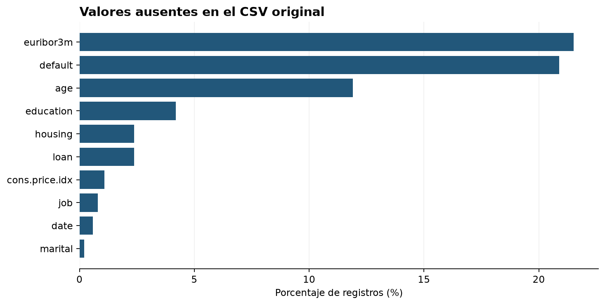
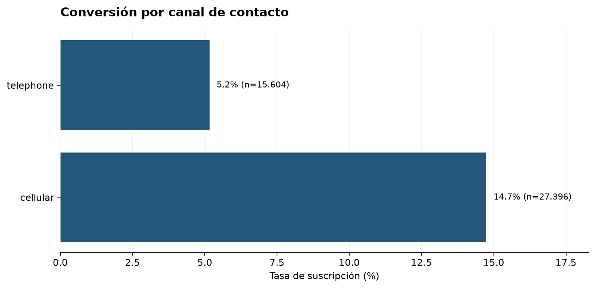
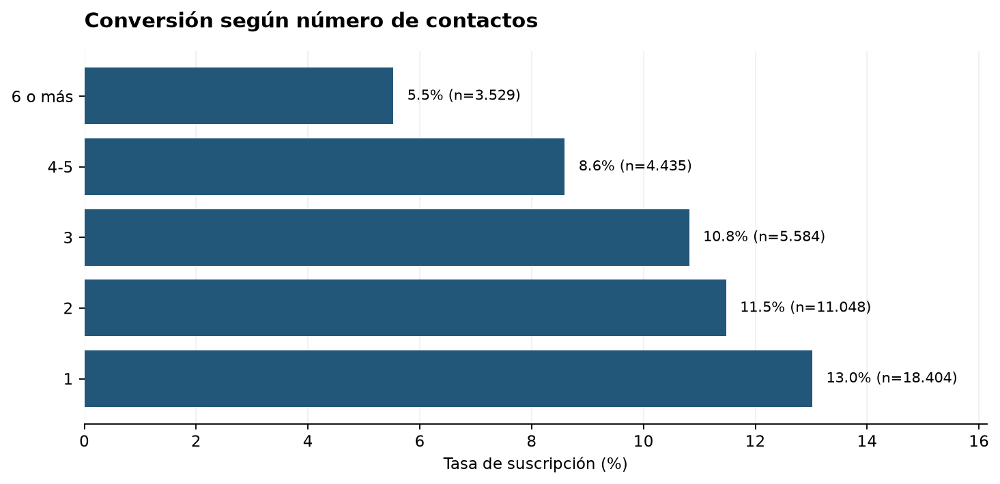
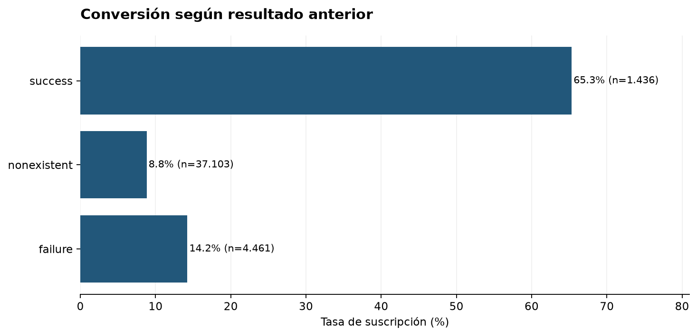
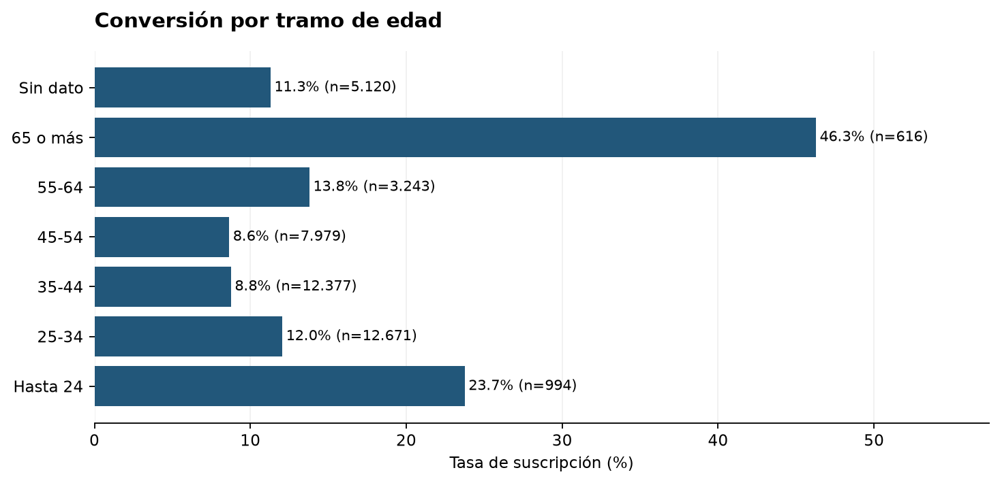
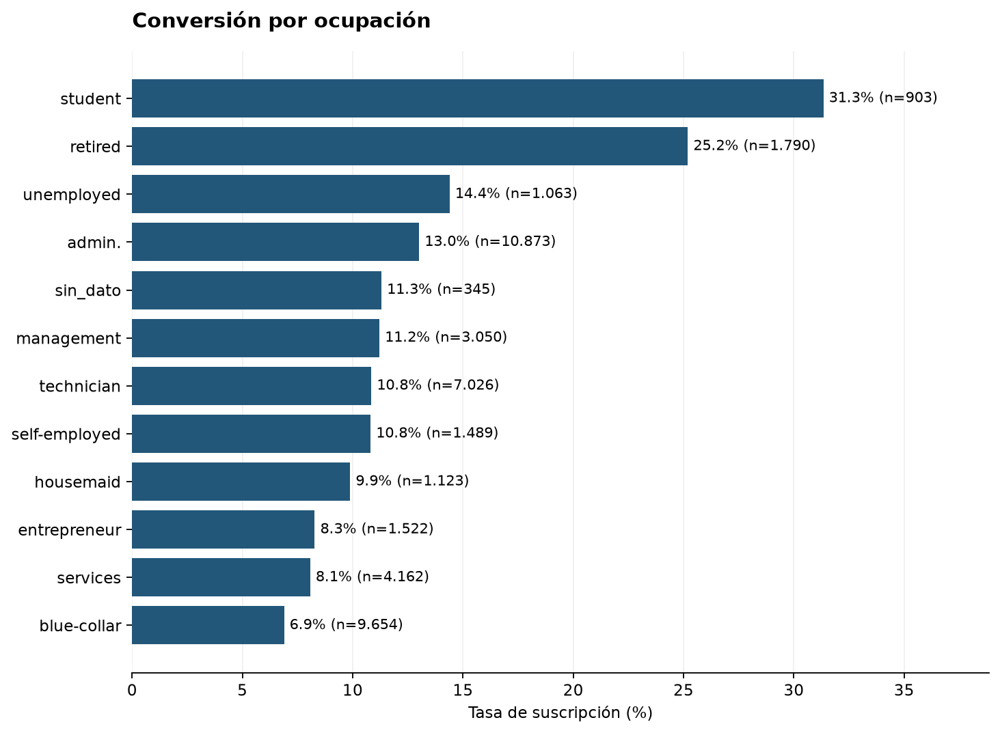
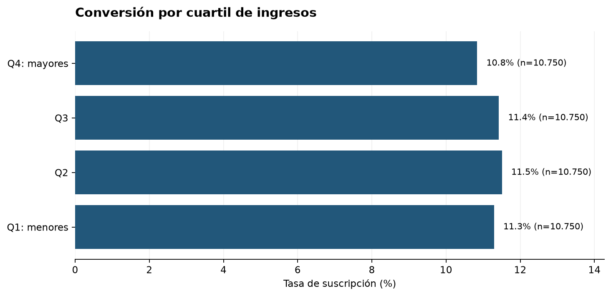
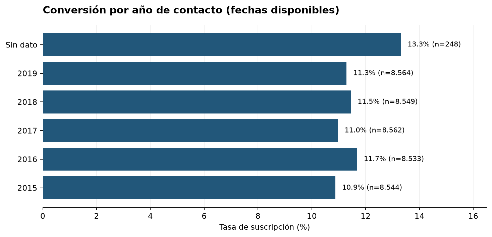
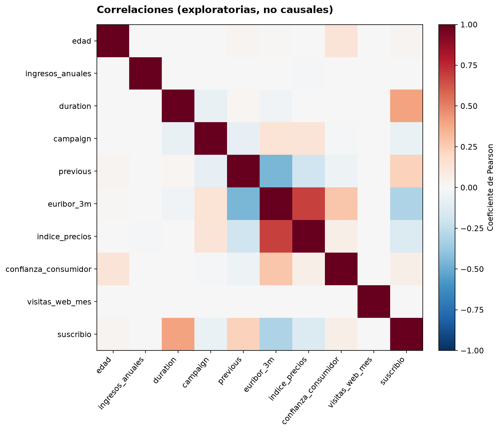

# Informe de análisis exploratorio: campañas de marketing bancario

## Planteamiento

El análisis parte de dos archivos: el historial de contactos comerciales de una entidad bancaria portuguesa y un conjunto de fichas de clientes con ingresos, composición del hogar y actividad web. El resultado que queremos explicar de forma descriptiva es la suscripción o no de un depósito a plazo (`y`).

La pregunta empresarial que guía el trabajo es qué características aparecen asociadas con mejores resultados comerciales y cuáles de ellas serían realmente utilizables en la planificación de una campaña. No se pretende entrenar un modelo predictivo ni atribuir causalidad a las asociaciones observadas.

## 1. Alcance y calidad de los datos

El CSV contiene **43.000 registros**, con **4.844 suscripciones** y **38.156 no suscripciones**. La tasa observada de conversión es del **11,27 %**. El conjunto adicional de clientes tiene **43.170 fichas** repartidas en tres hojas (2012, 2013 y 2014). Todas las campañas pueden relacionarse con una ficha y hay 170 fichas que no figuran en las campañas; no se incorporan al denominador. La unión se ha validado mediante identificadores únicos para evitar duplicar contactos.

La información necesita varias transformaciones para poder analizarse de forma correcta:

- Se han convertido a formato numérico cuatro columnas económicas (`cons.price.idx`, `cons.conf.idx`, `euribor3m` y `nr.employed`). Las tres primeras presentan **coma decimal** y la última viene como texto numérico. Así evitamos errores al calcular medias y correlaciones.
- Las fechas incluyen nombres de meses en castellano, por lo que requieren una conversión explícita.
- Hay valores ausentes relevantes: 9.256 casos sin Euríbor a tres meses; 8.981 sin información sobre incumplimientos; 5.120 sin edad; y 248 sin fecha de contacto.
- La variable `pdays` contiene el valor `999` en **41.412** observaciones. Se conserva como código de origen y se excluye de los cálculos de días reales mediante una columna derivada.
- Las columnas `latitude` y `longitude` no están documentadas en el enunciado. No se usan para inferencias territoriales sin más validación.

No he eliminado filas por el mero hecho de contener ausencias, porque hacerlo reduciría la muestra y podría alterar las proporciones. Los cálculos por segmentos se realizan con los datos realmente disponibles y se muestran sus tamaños muestrales.

## 2. Resultado general y canales

El canal móvil registra **4.039 suscripciones entre 27.396 contactos** (**14,74 %**). El teléfono convencional tiene **805 entre 15.604** (**5,16 %**), una diferencia aproximada de **9,58 puntos porcentuales**.

La separación es suficientemente amplia para justificar una revisión comercial. Aun así, debemos tener cuidado: no sabemos si el canal se decide por perfil del cliente, disponibilidad del número, momento de la campaña u otro factor. En consecuencia, la comparación permite formular hipótesis, pero no demostrar que llamar por móvil sea la causa de la mayor conversión.

## 3. Número de contactos

Los registros que muestran **un único contacto** tienen una conversión del **13,02 %** (18.404 casos). En las campañas con **seis o más contactos**, la proporción se sitúa en **5,53 %** (3.529 casos). Los grupos intermedios forman una secuencia decreciente.

Una interpretación precipitada sería concluir que volver a llamar perjudica la conversión. Sin embargo, lo razonable es considerar también la selección: los casos más difíciles pueden necesitar más llamadas y terminar convirtiendo menos. Antes de fijar límites comerciales haría falta estudiar el orden de los contactos, las características de los clientes y los costes.

## 4. Historial de campañas anteriores

Es una de las variables más interesantes del dataset. Cuando `poutcome` indica **éxito en una campaña anterior**, encontramos **938 suscripciones en 1.436 registros**, una tasa de **65,32 %**. Entre los casos sin resultado previo (`nonexistent`), la tasa es **8,82 %** (3.271 suscripciones sobre 37.103 registros). La categoría de fracaso previo alcanza el **14,23 %**.

Es una señal de comportamiento comercial previo, y parece más discriminante que la renta por sí sola. Para el banco sería razonable investigar una estrategia diferenciada para contactos con antecedentes positivos, sin confundir esta observación con una relación causal demostrada.

## 5. Edad, ocupación e ingresos

La conversión no es uniforme por edad. Entre los registros **de 65 años o más** alcanza el **46,27 %**, aunque ese segmento solo cuenta con **616 observaciones**. Entre los **35–44 años** es del **8,75 %**. La edad tiene 5.120 valores ausentes, por lo que hay que mantener visible ese grupo.

Por ocupación, `student` registra **31,34 %** (903 casos) y `retired` **25,20 %** (1.790 casos), frente a **6,89 %** en `blue-collar` (9.654 casos). Estas diferencias no deberían interpretarse de forma aislada: edad, ocupación, canal de contacto y resultado previo pueden estar relacionados entre sí.

Los ingresos anuales se han dividido en cuartiles de igual tamaño (10.750 registros cada uno). Las tasas resultantes van aproximadamente del **10,84 % al 11,51 %**. La diferencia es pequeña respecto a las observadas en otras variables. No parece adecuado definir la estrategia comercial únicamente a partir de la renta con estos datos.

## 6. Tiempo, estadísticas y correlaciones

La variable `date` dispone de fechas para **42.752 registros**, distribuidos entre 2015 y 2019. Estos años corresponden al contacto comercial y no deben confundirse con los nombres de las hojas del Excel (2012–2014), que identifican cohortes de alta de clientes. La tasa de conversión anual oscila aproximadamente entre el **10,87 %** y el **11,68 %**, sin un crecimiento sostenido evidente en ese periodo.

Las estadísticas descriptivas muestran, para los registros con edad disponible, una **media de 39,98 años** y una **mediana de 38**. La duración de la última llamada presenta una **mediana de 179 segundos** y una **media de 257,74 segundos**, señal de una distribución con algunas llamadas bastante largas.

El coeficiente de correlación entre la duración de la llamada y la suscripción es aproximadamente **0,405**. Es una relación descriptiva llamativa, pero tiene una limitación decisiva: al inicio de la campaña no se conoce cuánto durará una llamada, por lo que esta información no serviría para decidir a quién llamar con antelación. En términos de modelización, utilizarla como predictor previo podría provocar *fuga de información* (*data leakage*).

## 7. Implicaciones para el negocio

Las tres preguntas que propondría estudiar después de este EDA son:

1. **¿Qué explica la diferencia de resultados por canal?** Revisar la composición de clientes y el criterio empleado para asignar móvil o teléfono convencional.
2. **¿Cómo aprovechar el historial comercial?** Analizar si los antecedentes positivos aportan una mejora consistente al segmentar por edad, ocupación y otras características.
3. **¿Cuántos intentos tienen sentido económicamente?** Relacionar conversión con coste por llamada, volumen y beneficio esperado por depósito, variables que no se proporcionan en los archivos actuales.

No podemos calcular ingresos ni rentabilidad de las campañas porque desconocemos los importes suscritos, el margen de cada depósito y los costes del proceso comercial. Tampoco podemos afirmar que una variable sea la causa del comportamiento observado basándonos exclusivamente en los gráficos.

## Conclusión

El EDA muestra que **el resultado previo de otras campañas, el canal y determinadas características demográficas tienen relaciones descriptivas claras con la suscripción**. Por el contrario, la renta anual por cuartiles apenas separa las tasas observadas. La oportunidad más interesante no es extraer una regla automática de estos porcentajes, sino identificar hipótesis útiles para diseñar un análisis posterior mejor controlado y, si se dispusiera de costes e importes contratados, estudiar también la eficiencia económica de las campañas.

La preparación de datos resulta tan importante como la visualización: el código especial `999`, los valores ausentes, las comas decimales y la unión entre fuentes podrían haber dado lugar a conclusiones erróneas si no se hubieran tratado expresamente.

**Reproducibilidad:** los datos limpios, gráficos y tablas que justifican estos resultados se generan ejecutando `python src/analisis_eda.py` desde la raíz del proyecto.
