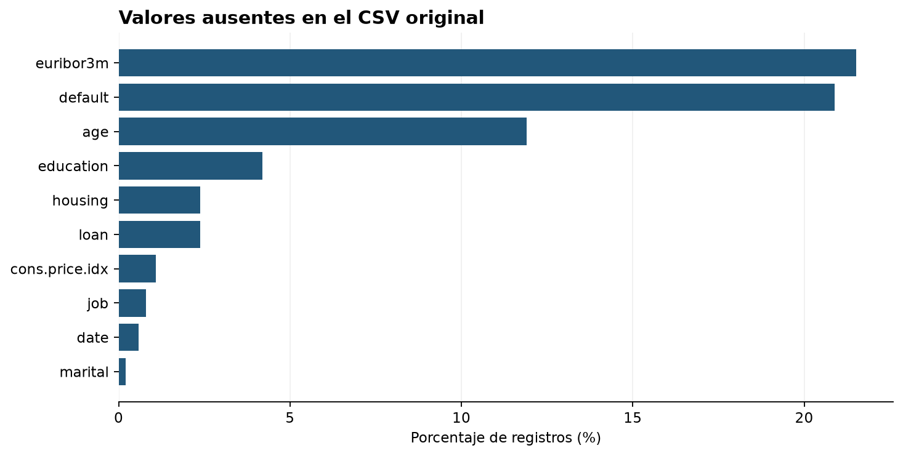
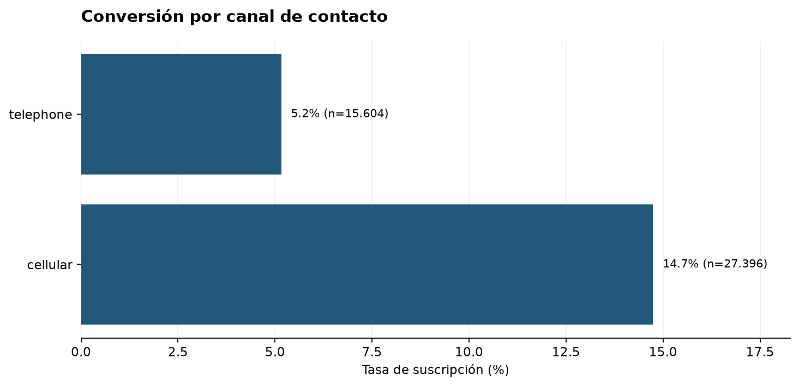
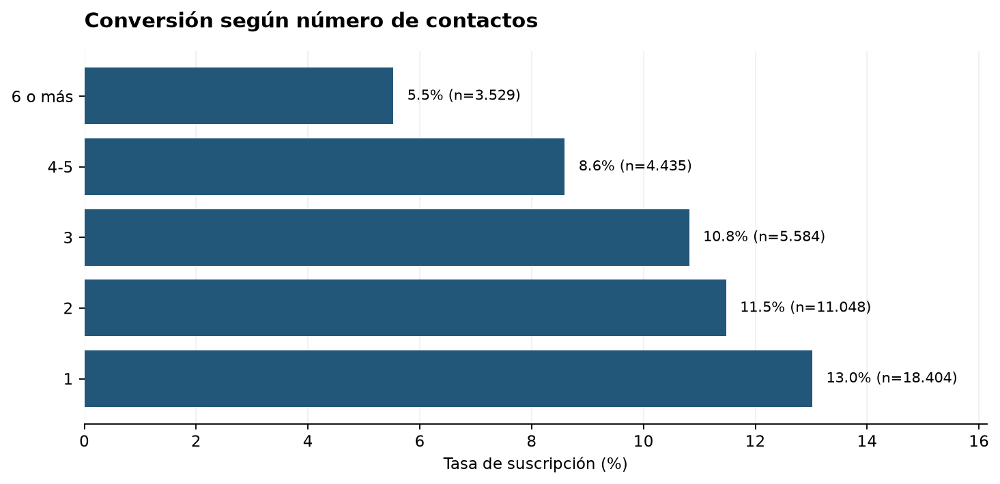
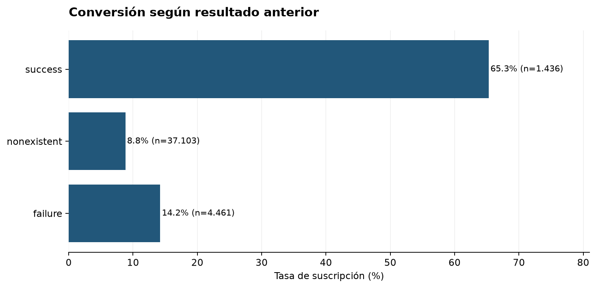
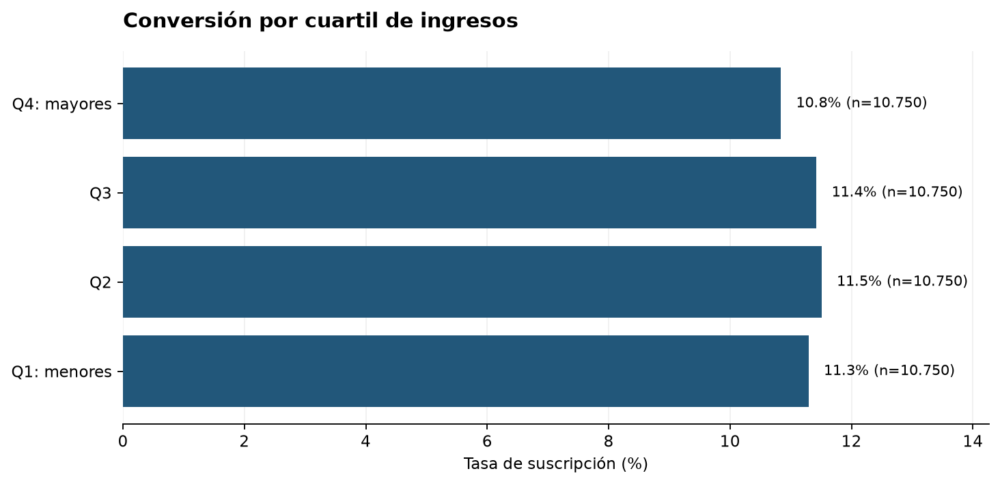

# DataProject: análisis exploratorio de campañas de marketing bancario

**Máster en Data Analytics · ThePowerMBA · Python for Data**

## 1. Objetivo

En este proyecto he trabajado con los datos de campañas telefónicas de una entidad bancaria portuguesa para estudiar qué variables se relacionan con la contratación de un depósito a plazo. La intención no es construir un modelo predictivo, sino **entender la calidad de los datos, describir el comportamiento de los contactos y encontrar patrones comerciales que merezca la pena investigar**.

Me interesaba especialmente separar dos preguntas: qué características tienen los registros que terminan en suscripción y qué información sería realmente útil **antes** de iniciar una llamada. No son necesariamente lo mismo.

## 2. Herramientas y fuentes

- **Python 3** y **pandas** para lectura, limpieza, uniones y agrupaciones.
- **NumPy** para tratamiento de datos y operaciones numéricas.
- **Matplotlib** para los gráficos.
- **Visual Studio Code** como editor recomendado para ejecutar y revisar el proyecto.
- **openpyxl** para que pandas pueda abrir el Excel.

Los dos archivos originales proporcionados por ThePowerMBA están en `datos/originales/`:

| Archivo | Contenido |
|---|---|
| `bank-additional.csv` | 43.000 registros de campañas, resultados de suscripción y variables asociadas. |
| `customer-details.xlsx` | 43.170 fichas repartidas en las hojas `2012`, `2013` y `2014`. |

He conservado ambos archivos sin modificar. El Excel tiene **170 fichas sin registro de campaña** y todas las campañas encuentran su ficha mediante `id_` / `ID`. Por eso la tabla final utiliza una unión `left` que mantiene los **43.000 registros de campañas**, sin incorporar como supuestas llamadas esas 170 fichas adicionales.

## 3. Cómo ejecutar el proyecto

Abre la carpeta del proyecto en Visual Studio Code. En una terminal de PowerShell situada en su raíz, ejecuta:

```powershell
python -m pip install -r requirements.txt
python src/analisis_eda.py
```

Para repetir las validaciones del código:

```powershell
python -m unittest discover -s tests -v
```

El script genera o actualiza los CSV de `datos/procesados/`, las tablas de `tablas/` y las imágenes de `graficos/`. No es necesario abrir manualmente cada archivo ni modificar las rutas: se calculan desde la ubicación del propio script.

## 4. Estructura del repositorio

```text
DataProject-EDA-Python/
├── README.md
├── INFORME_EDA.md
├── requirements.txt
├── datos/
│   ├── originales/
│   │   ├── bank-additional.csv
│   │   └── customer-details.xlsx
│   └── procesados/
│       ├── campanas_limpias.csv
│       ├── clientes_limpios.csv
│       └── datos_integrados.csv
├── src/
│   └── analisis_eda.py
├── tests/
│   └── test_eda.py
├── tablas/
│   ├── resumen_metricas.json
│   └── [tablas estadísticas y de segmentación]
└── graficos/
    └── [nueve gráficos PNG]
```

## 5. Preparación y limpieza de los datos

Antes de calcular métricas he revisado las columnas, el número de registros, los identificadores y los valores ausentes. Las principales decisiones han sido:

1. **Eliminar columnas de índice exportadas** (`Unnamed: 0`), ya que no aportan información del negocio.
2. **Convertir importes e indicadores con coma decimal** a tipos numéricos (`euribor3m`, índice de precios, confianza del consumidor y número de empleados de la economía).
3. **Transformar fechas con meses en castellano** (`2-agosto-2019`) a fechas de Python. De ellas salen el mes y el año de contacto.
4. **Normalizar campos de texto**, conservando `sin_dato` como categoría explícita cuando falta información. No he tratado las ausencias como respuestas negativas.
5. **Mantener la edad y el Euríbor faltantes como valores ausentes**, en lugar de sustituirlos por una media inventada. Así las estadísticas de esas variables utilizan los registros que realmente disponen de información.
6. **Tratar `pdays = 999` como código especial**, no como 999 días reales. El dato original se conserva y se crea una columna auxiliar para cálculos.
7. **Unificar las tres hojas del Excel** y relacionarlas con el CSV mediante su identificador. Se valida que la relación sea uno a uno.
8. **Crear grupos** de edad, número de contactos y cuartiles de ingresos para facilitar las comparaciones.

Los valores ausentes más relevantes del CSV original son: **9.256 en `euribor3m`**, **8.981 en `default`**, **5.120 en `age`**, **1.807 en `education`** y **248 en `date`**. La transformación conserva las 43.000 observaciones de campañas.



## 6. Resultados principales

En los **43.000 registros** hay **4.844 suscripciones**, equivalentes a una **tasa global del 11,27 %**.

| Indicador | Resultado |
|---|---:|
| Contactos por móvil: conversión | 14,74 % |
| Contactos por teléfono convencional: conversión | 5,16 % |
| Con un contacto durante la campaña | 13,02 % |
| Con seis o más contactos | 5,53 % |
| Campaña anterior exitosa | 65,32 % |
| Sin resultado previo registrado | 8,82 % |







### Interpretación

**El historial de contacto parece especialmente relevante.** Los registros con un resultado positivo en la campaña anterior presentan tasas mucho mayores. Es un buen candidato para estudiar una segmentación comercial, aunque el análisis por sí solo no demuestra que ese antecedente cause una nueva contratación.

**El canal de contacto muestra diferencias importantes.** La conversión del canal móvil es superior a la del teléfono convencional en esta muestra. Sin información adicional sobre cómo se asignaron los clientes a cada canal, no se puede concluir que cambiar el canal produzca esa diferencia.

**Más intentos se asocian con menor conversión observada.** Eso puede indicar dificultad para contactar o convencer a ciertos clientes, y no necesariamente que la repetición de llamadas reduzca las contrataciones. La dirección de la relación no está demostrada.

**Los ingresos aportan poca diferenciación descriptiva.** Los cuatro cuartiles se sitúan cerca del 11 % de conversión; por tanto, no usaría el nivel de renta por sí solo para priorizar clientes con estos datos.



## 7. Límites del análisis

- Se trata de **asociaciones descriptivas**, no de estimaciones causales.
- La variable `duration` mide la duración de la llamada; se conoce **después** del contacto y no debe utilizarse como si estuviera disponible para seleccionar clientes antes de llamar.
- Los registros con edades, Euríbor o fechas ausentes se mantienen. Los denominadores varían según la variable analizada.
- Las coordenadas del CSV no se utilizan para extraer conclusiones geográficas: no se dispone de una validación de que representen ubicaciones pertinentes para el banco portugués.
- El CSV no incluye ingresos obtenidos por las suscripciones, costes comerciales ni margen financiero. Por tanto, no es posible calcular rentabilidad económica real de una campaña.

## 8. Conclusión

Mi principal conclusión es que **la calidad del dato y su interpretación condicionan cualquier decisión posterior**. El dataset permite identificar diferencias entre grupos, especialmente en el historial de campañas y el canal de contacto. Sin embargo, convertir esas diferencias en una política comercial exige contrastarlas con el proceso de asignación de clientes, los costes y el margen generado.

El informe ampliado está en [`INFORME_EDA.md`](INFORME_EDA.md). Las tablas con los recuentos y denominadores de cada comparación están disponibles en `tablas/` para poder revisar los resultados, no solo los gráficos.
